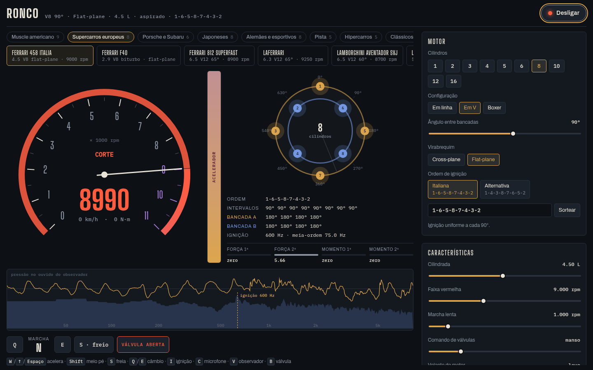
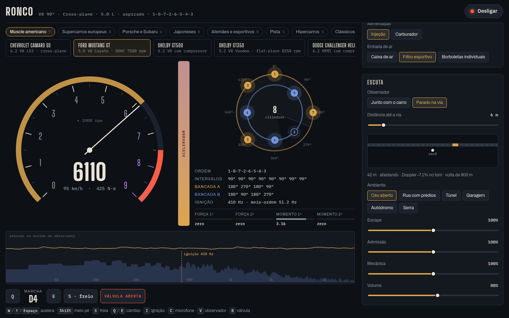
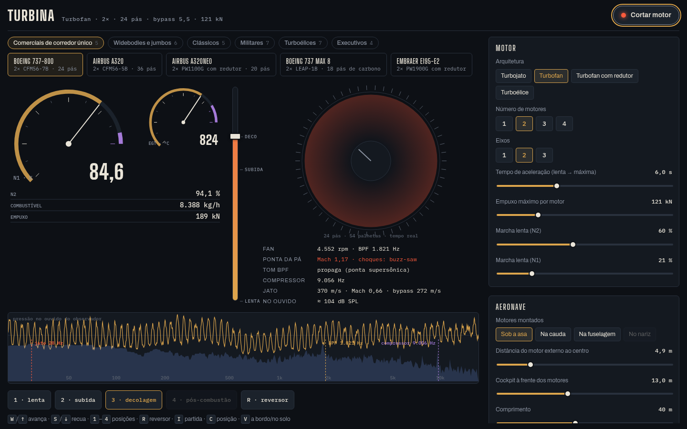
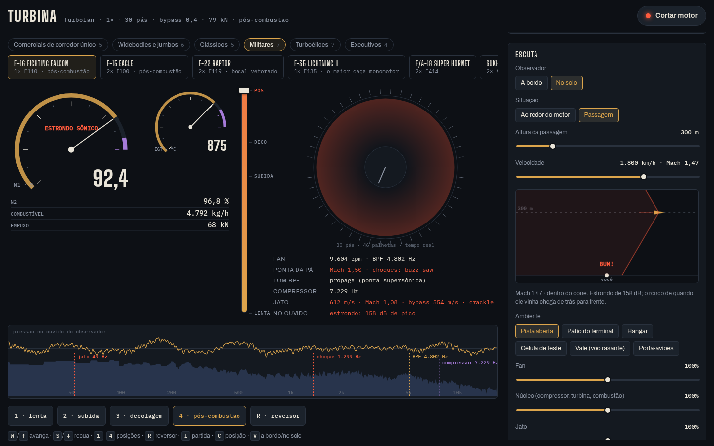

# Ronco e Turbina

Dois simuladores de som de motor que rodam direto no navegador.

- **Ronco**, motores de carro e moto: https://ezenere.com/data/engine/index.html
- **Turbina**, motores de avião: https://ezenere.com/data/engine/jato.html

Nenhum som aqui é gravação. Tudo é criado na hora pelo computador, a partir de como o motor funciona de verdade: as explosões dentro dos cilindros, o ar passando pelo escapamento, as pás girando na turbina. Por isso o som muda sozinho quando você muda qualquer peça.

## Ronco (carros e motos)

Escolha um carro na lista de cima. Tem muscle car americano, Ferrari, Porsche, japoneses, clássicos brasileiros como Opala e Fusca, carros de corrida e motos. Depois é só ligar e acelerar.

Dá para mexer em quase tudo:

- quantos cilindros o motor tem e como eles são arrumados (em linha, em V, boxer);
- a ordem em que os cilindros explodem;
- o escapamento: abafador, válvula, diâmetro, ressonador;
- turbo ou compressor;
- câmbio: número de marchas, manual ou automático, a relação de cada marcha e o tempo de troca;
- 2-step (corte ou controle de largada).

Você também escolhe de onde ouve: ao lado do escape, atrás do carro, dentro da cabine, no cofre do motor ou parado na rua vendo o carro passar. E escolhe o lugar: céu aberto, rua com prédios, túnel, garagem, autódromo ou serra.

**Teclas:** `I` liga · `W` acelera · `S` freia · `E` e `Q` trocam marcha · `C` muda o microfone · `V` alterna entre dentro do carro e na rua · `B` abre e fecha a válvula do escape.

## Turbina (aviões)

Escolha um avião: Boeing 737, Airbus A320, 747, Concorde, caças como F-16 e F-22, turboélices como ATR e Super Tucano, jatos executivos.

Você dá a partida, que leva uns 15 segundos como num avião de verdade. Depois empurra a manete e ouve o motor de vários lugares:

- em volta do motor, no chão (é só arrastar no mapa);
- dentro do avião, na cabine ou no cockpit;
- vendo o avião passar por cima. Acima da velocidade do som, você ouve o estrondo sônico.

Também dá para pôr pós-combustão em qualquer jato, usar reversor e trocar peças do motor.

**Teclas:** `I` partida · `W` e `S` mexem a manete · `1` a `4` posições da manete · `R` reversor · `C` muda a posição · `V` alterna entre a bordo e no solo.

## Dicas

- Use fone de ouvido: o som tem esquerda e direita.
- O volume pode ficar alto, principalmente nos caças e no estrondo sônico. Comece baixo.
- Funciona melhor no computador, mas também abre no celular.

## Rodar no seu computador

Baixe esta pasta e abra o arquivo `index.html` (carros) ou `jato.html` (aviões) no navegador. Não precisa instalar nada.

## Quer saber como funciona por dentro?

O documento [Como o Ronco e a Turbina funcionam](docs/TECNICO.md) explica a física e o processamento de som de cada parte: cilindros, escapamento, câmbio, temperatura, turbinas, estrondo sônico, e também como adicionar novos carros e aviões.
